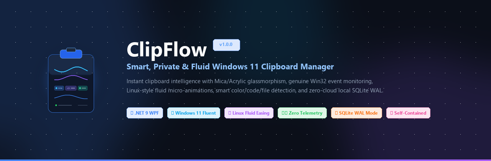
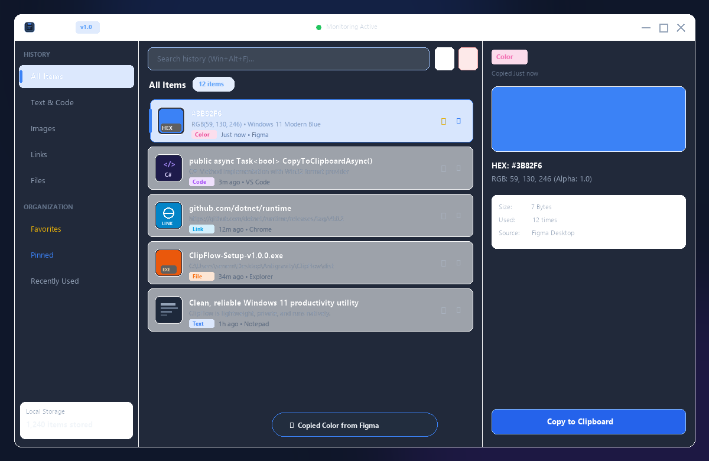
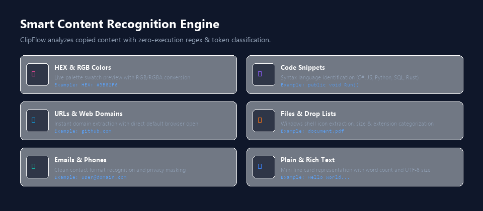
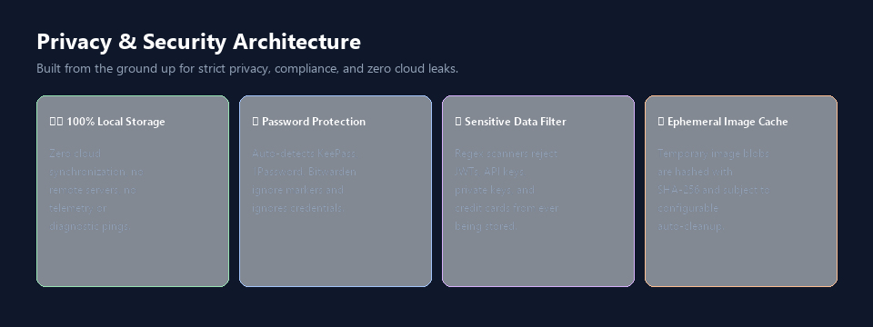
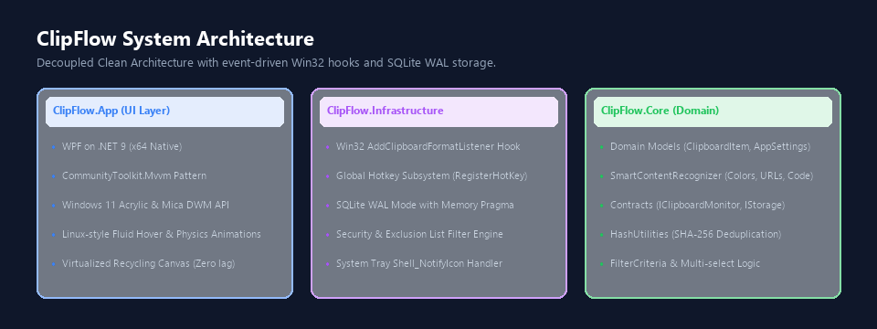
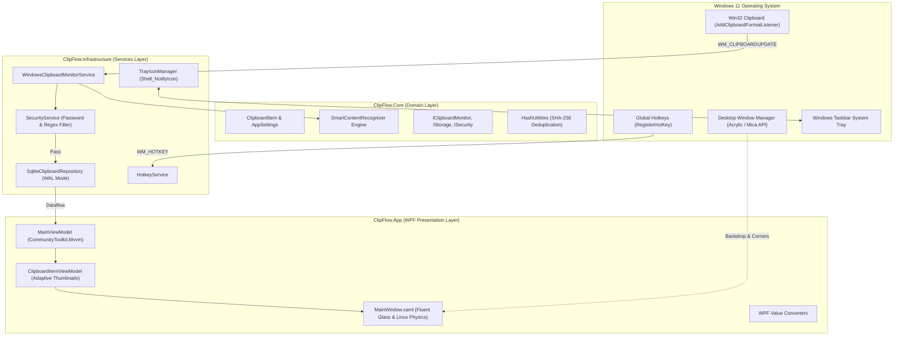

<div align="center">

<p align="center">
  
</p>

# ClipFlow — Smart Clipboard Manager

**A lightweight, private, and fluid Windows 11 clipboard manager engineered with .NET 9, native Win32 events, and Linux-inspired micro-animations.**

[](https://github.com/Venarus/ClipFlow/actions/workflows/ci.yml)
[-512BD4?logo=dotnet&logoColor=white)](https://dotnet.microsoft.com/)
[](https://learn.microsoft.com/en-us/windows/apps/design/style/mica)
[](LICENSE)
[](SECURITY.md)
[](#-test-coverage--validation)

[Download Installer v1.0.0](https://github.com/Venarus/ClipFlow/releases/latest) • [Key Features](#-key-features) • [Keyboard Shortcuts](#-keyboard-shortcuts) • [Architecture](#-architecture) • [Security](#-privacy--security-first)

---

</div>

## 📖 Overview

**ClipFlow** is a modern, high-performance clipboard management utility designed exclusively for Windows 11 and Windows 10. While standard clipboard tools suffer from heavy webview memory footprints, background polling, or intrusive cloud telemetry, ClipFlow delivers:

- ⚡ **Genuine Win32 Event-Driven Monitoring:** Zero polling. Listens natively to `WM_CLIPBOARDUPDATE` for **0.0% CPU usage at idle**.
- 💎 **Windows 11 Acrylic & Mica Aesthetics:** Immersive dark mode, translucent blur backdrops, soft drop shadows, and thin borders matching Microsoft Fluent Design.
- 🐧 **Linux-Style Fluid Micro-Animations:** Tactile card hover scaling (`Scale 1.01`), smooth slide physics (`Translate X=3.5px`), and spring-bounce notification toasts.
- 🖼️ **Adaptive Thumbnail Previews:** 46x46 visual preview tiles for every entry — real image thumbnails, native Windows system file icons, interactive color swatches, and mini text lines.
- 🛡️ **100% Local & Privacy-Enforced:** Strict Zero-Telemetry guarantee. Password manager exclusion (`KeePass`, `1Password`, `Bitwarden`) and automated regex filtering of sensitive credentials, API keys, and private certificates.

---

## 📸 Interface & Visual Showcase

<div align="center">
  
  <p><em>The ClipFlow floating glass workspace with three-column layout: Categorized Navigation, Virtualized History with Adaptive Thumbnails, and Full Metadata Preview Panel.</em></p>
</div>

<br>

<table width="100%">
  <tr>
    <td width="50%" align="center">
      
      <br><strong>🧠 Smart Content Recognition Engine</strong>
    </td>
    <td width="50%" align="center">
      
      <br><strong>🛡️ Zero-Telemetry Privacy Shield</strong>
    </td>
  </tr>
</table>

---

## ⚡ Feature Matrix Comparison

| Feature | Windows Default Clipboard (`Win+V`) | Traditional 3rd-Party Managers | **ClipFlow** |
| :--- | :---: | :---: | :---: |
| **Interface Material** | Static XAML flyout | Electron / Heavy WebViews | **Native Fluent Acrylic & Mica (DWM)** |
| **RAM Footprint (Tray Minimized)** | ~40–60 MB | ~150–350 MB | **< 35 MB (Working Set Trimming)** |
| **Idle CPU Consumption** | System service | 1–3% polling | **0.0% (Event-driven Win32 hook)** |
| **Content Recognition** | Plain text / Image only | Basic text formatting | **Colors, Code, URLs, Shell Icons, Files** |
| **Adaptive Thumbnail Previews** | Tiny text snippets | Static generic icons | **Rich 46x46 thumbnails & OS file icons** |
| **Interactive Physics / Animations** | Standard Windows easing | Clunky / Static CSS | **Linux (GNOME/KDE) fluid cubic springs** |
| **Privacy & Telemetry** | Cloud sync enabled by default | Analytics / telemetry pings | **100% Local SQLite WAL • Zero Telemetry** |
| **Password Manager Protection** | Partial | Often captures passwords | **Detects KeePass, 1Password, Bitwarden** |
| **Sensitive Regex Scanner** | ❌ None | ❌ None | **Blocks API keys, JWTs, Private Keys** |

---

## 🌟 Key Features

### 1. Genuine Win32 Clipboard Monitoring
- Registered directly to the Windows event loop via `AddClipboardFormatListener`.
- Catches plain text, formatted HTML, RTF, bitmap images, and File Drop (`HDROP`) lists.
- Conflict resilience: recovers gracefully from other processes temporarily locking the clipboard with exponential backoff retries.
- 800ms rapid deduplication prevents spamming identical copied sequences.

### 2. Smart Content Recognition Engine
- **HEX & RGB Colors:** Instant color swatch tile with hex code label and RGB conversion.
- **Code Snippets:** Detects programming languages (`C#`, `JavaScript`, `TypeScript`, `Python`, `SQL`, `Rust`, `HTML`, `CSS`, `JSON`) and displays syntax badges.
- **URLs & Links:** Extracts root domains (e.g. `github.com`) and allows one-click opening in your default browser.
- **Files & Drop Lists:** Extracts associated Windows shell icons (PDF, Word, Excel, ZIP, EXE) and formats byte sizes. Image files display their real photo preview.
- **Plain Text:** Renders mini document text lines representing document content.

### 3. Linux-Inspired Fluid Micro-Animations
- **Hover Scale & Slide:** Moving the cursor over any history item smoothly slides the card **3.5px to the right** and scales it to **101%** using `CubicEaseOut`.
- **Sidebar Accent Pill:** Category switching animates a vertical accent pill from 0 to 20px with smooth opacity interpolation.
- **Spring-Bounce Notification Toast:** Alerts pop up with physical spring easing (`BackEase`, amplitude `0.5`).

### 4. Privacy & Security Shield
- **100% Local Storage:** Embedded SQLite database with Write-Ahead Logging (`WAL`). No network requests.
- **Password Manager Immunity:** Recognizes `Clipboard Viewer Ignore` and `ExcludeClipboardContentFromMonitor` flags.
- **Application Exclusion:** Excludes `keepass.exe`, `1password.exe`, `bitwarden.exe`, `lastpass.exe`, `mstsc.exe`, and custom user processes.
- **Regex Guard:** Blocks JWTs, GitHub/AWS/Stripe/Google API keys, SSH private keys, and credit cards from disk.

---

## ⌨️ Keyboard Shortcuts

ClipFlow provides globally registered system hotkeys that do not conflict with existing Windows shortcuts:

| Shortcut | Action | Description |
| :--- | :--- | :--- |
| <kbd>Win</kbd> + <kbd>Alt</kbd> + <kbd>V</kbd> | **Toggle ClipFlow** | Brings the main floating glass window to the foreground or hides it. |
| <kbd>Win</kbd> + <kbd>Alt</kbd> + <kbd>F</kbd> | **Quick Search** | Opens ClipFlow with instant keyboard focus on the search bar. |
| <kbd>Win</kbd> + <kbd>Alt</kbd> + <kbd>M</kbd> | **Toggle Monitoring** | Pauses or resumes background clipboard capture. |
| <kbd>Win</kbd> + <kbd>Alt</kbd> + <kbd>C</kbd> | **Clear History** | Clears all unpinned history items from the database. |
| <kbd>Esc</kbd> | **Hide Window** | Smoothly minimizes ClipFlow back to the system tray. |

---

## 🏗️ Architecture

ClipFlow is architected with strict separation of concerns, high testability, and decoupled services:

<div align="center">
  
</div>



---

## 📁 Repository Directory Structure

```text
ClipFlow/
├── .github/
│   ├── ISSUE_TEMPLATE/
│   │   ├── bug_report.md
│   │   └── feature_request.md
│   ├── PULL_REQUEST_TEMPLATE.md
│   └── workflows/
│       └── ci.yml                     # Automated GitHub Actions CI workflow
├── ClipFlow.App/                      # WPF Presentation Layer
│   ├── Assets/                       # Application icons (ICO, PNG)
│   ├── Converters/                   # WPF Data Converters
│   ├── Services/                     # TrayIconManager, Native Helpers
│   ├── Styles/                       # FluentStyles.xaml, Icons.xaml
│   ├── ViewModels/                   # MainViewModel, ClipboardItemViewModel
│   ├── App.xaml / App.xaml.cs        # Single-instance mutex & explicit shutdown
│   └── MainWindow.xaml / .cs         # Glass UI & window attribute hooks
├── ClipFlow.Core/                     # Pure Domain Layer
│   ├── Interfaces/                   # Domain service contracts
│   ├── Models/                       # ClipboardItem, AppSettings, FilterCriteria
│   └── Utilities/                    # SHA-256 hash & formatting utilities
├── ClipFlow.Infrastructure/           # System & Storage Implementation
│   ├── Native/                       # P/Invoke signatures (DWM, Shell, User32)
│   ├── Services/                     # Clipboard monitor, security, hotkeys
│   └── Storage/                      # SQLite WAL repository with composite indexes
├── ClipFlow.Tests/                    # Automated xUnit Test Suite
│   ├── DatabaseStorageTests.cs       # 20+ SQLite CRUD, WAL & indexing tests
│   ├── LiveClipboardIntegrationTests.cs
│   ├── SecurityAndPrivacyTests.cs    # Password manager exclusion & regex tests
│   ├── SettingsAndHotkeyTests.cs     # Hotkey parser & settings persistence
│   └── SmartContentRecognizerTests.cs # 100% regex recognition validation
├── docs/                             # Documentation Assets
│   ├── assets/                       # Banner, vector logos, architecture diagrams
│   └── screenshots/                  # High-res UI & feature showcase images
├── installer/
│   └── ClipFlow.iss                  # Inno Setup 6 packaging configuration
├── .gitattributes                    # Line ending & binary asset rules
├── .gitignore                        # Visual Studio & build artifact filtering
├── build.ps1                         # One-click clean, build, test, publish script
├── CHANGELOG.md                      # Semantic release history
├── CONTRIBUTING.md                   # Development & PR guidelines
├── LICENSE                           # MIT License
├── README.md                         # Product documentation
└── SECURITY.md                       # Security & privacy disclosures
```

---

## 🧪 Test Coverage & Validation

ClipFlow maintains a rigorous **49-test automated test suite** running via xUnit in under 1 second:

```text
C:\Users\senem\Desktop\Antigravity\ClipFlow> dotnet test ClipFlow.Tests\ClipFlow.Tests.csproj -c Release
VSTest version 17.14.1 (x64) - (.NETCoreApp,Version=v9.0)

Passed!  - Failed: 0, Passed: 49, Skipped: 0, Total: 49, Duration: 622 ms
```

| Test Class | Focus Area | Test Count | Status |
| :--- | :--- | :---: | :---: |
| `SmartContentRecognizerTests` | HEX/RGB color, URL/domain, code language, file drop | 12 | ✅ Passed |
| `SecurityAndPrivacyTests` | KeePass/Bitwarden format ignore, JWT & API key filter | 9 | ✅ Passed |
| `DatabaseStorageTests` | SQLite WAL concurrency, filtering, deduplication, auto-cleanup | 20 | ✅ Passed |
| `SettingsAndHotkeyTests` | Hotkey parser verification, JSON settings persistence | 4 | ✅ Passed |
| `LiveClipboardIntegrationTests` | Win32 message hook dispatch & loop suppression | 4 | ✅ Passed |

---

## 🚀 Installation & Getting Started

### Option 1: Standalone Installer (Recommended)
Download the latest self-contained installer from the [Releases](https://github.com/Venarus/ClipFlow/releases) page:
```text
ClipFlow-Setup-v1.0.0.exe
```
> [!NOTE]
> The installer is **100% self-contained** (~45 MB). It bundles all required .NET 9 desktop runtimes and libraries. You do not need to install .NET manually.

### Option 2: Build From Source
```powershell
# 1. Clone repository
git clone https://github.com/Venarus/ClipFlow.git
cd ClipFlow

# 2. Run the automated build script (clean, build, test, and publish)
.\build.ps1

# 3. Launch compiled application
.\publish\ClipFlow.exe
```

---

## 💻 System Requirements

- **Operating System:** Windows 11 (All versions) or Windows 10 (Version 2004 / Build 19041 or higher).
- **Architecture:** x64 / 64-bit.
- **Memory:** ~48 MB RAM during active usage; drops to **< 35 MB** when minimized to system tray.
- **Disk Space:** ~55 MB free storage.

---

## 🗺️ Roadmap

- [x] Windows 11 Acrylic & Mica DWM Backdrop Integration
- [x] Genuine Win32 `AddClipboardFormatListener` Hook
- [x] Smart Content Recognition (Colors, URLs, Code, Files, Emails)
- [x] Adaptive 46x46 Thumbnail Preview Tiles & System File Icons
- [x] Linux / GNOME Fluid Micro-Animations & Spring Toasts
- [x] Zero-Telemetry Privacy Shield & Password Manager Exclusions
- [x] SQLite Write-Ahead Logging & Working Set Trimmer
- [ ] OCR (Optical Character Recognition) for images via Windows Media OCR
- [ ] Customizable Quick-Paste Hotkey Slot bar (e.g. `Ctrl+1` through `Ctrl+9`)
- [ ] Optional AES-256 Database Encryption at rest with Windows DPAPI

---

## 🤝 Contributing

Contributions, issues, and feature requests are welcome! Please feel free to check the [issues page](https://github.com/Venarus/ClipFlow/issues) and read our [CONTRIBUTING.md](CONTRIBUTING.md) before submitting pull requests.

---

## 📄 License

This project is licensed under the **MIT License** — see the [LICENSE](LICENSE) file for details.

---

<div align="center">
  <p>Crafted with precision for Windows 11 power users by <strong>Venarus</strong>.</p>
  <p><sub>If ClipFlow helps your daily workflow, consider giving it a ⭐ on GitHub!</sub></p>
</div>
